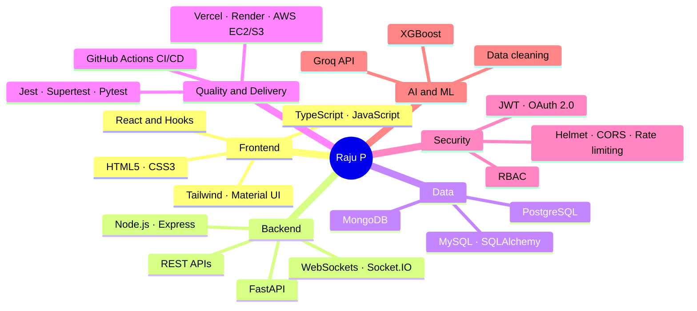
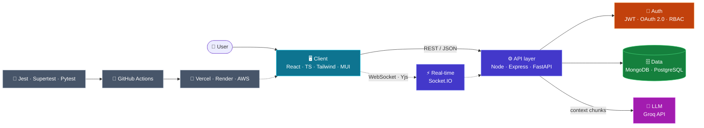
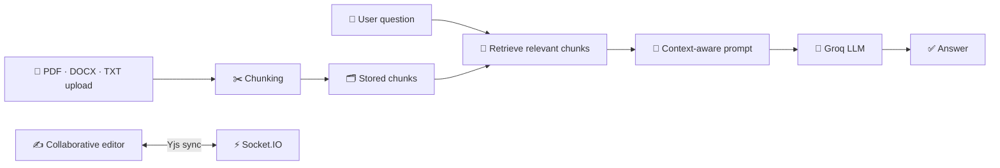
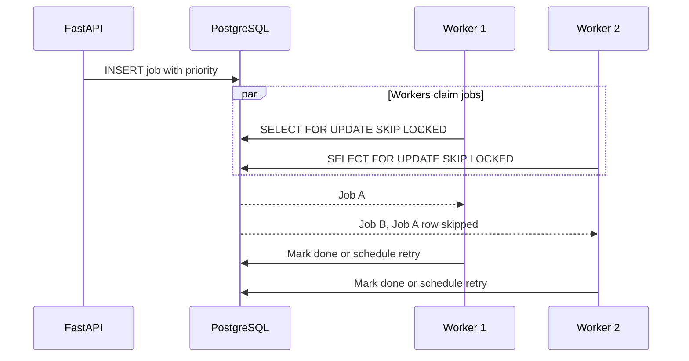
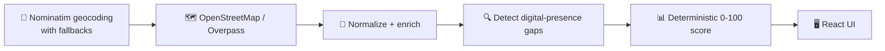
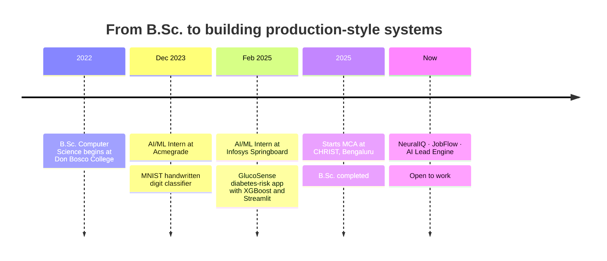

<div align="center">


<a href="https://github.com/Raju-CS8">
  
</a>

<br/>

[](https://nerual-ai.vercel.app/)
[](https://linkedin.com/in/raju-p-08737a2a5)
[](mailto:rajupalani811@gmail.com)


<sub>
<a href="#scan">Scan</a> &nbsp;·&nbsp; <a href="#whoami">Whoami</a> &nbsp;·&nbsp; <a href="#universe">Tech Universe</a> &nbsp;·&nbsp; <a href="#blueprint">Blueprint</a> &nbsp;·&nbsp; <a href="#projects">Projects</a> &nbsp;·&nbsp; <a href="#journey">Journey</a> &nbsp;·&nbsp; <a href="#signal">GitHub Signal</a> &nbsp;·&nbsp; <a href="#contact">Contact</a>
</sub>

</div>

<br/>

<a id="scan"></a>
## ⚡ The 30-Second Scan

> *Short on time? Here's everything a recruiter needs, up front.*

<div align="center">

| 🎯 Target | 🧰 Core Stack | 📈 Proof | 📍 Where |
|:---:|:---:|:---:|:---:|
| Full Stack · SDE-1 · Backend · Frontend/React · Python · AI/ML | React · Node.js · Express · FastAPI · MongoDB · PostgreSQL | **52/52** + **48/48** automated tests passing across two projects | Bengaluru · Pune · Mumbai · Remote |


</div>

<br/>

<a id="whoami"></a>
## 🧬 `whoami`

```console
raju@github:~$ whoami
Raju P  |  Full Stack Developer  |  Bengaluru, India

raju@github:~$ cat education.txt
MCA                 CHRIST (Deemed to be University), Bengaluru   2025-2027   CGPA 7.5/10
B.Sc. Computer Sci. Don Bosco College (Co-Ed), Tirupattur        2022-2025   CGPA 7.1/10

raju@github:~$ cat principles.txt
[x] Ship it, then test it until the numbers say it works
[x] Secure by default: auth, RBAC, validation, rate limiting
[x] Reliability beats cleverness: retries, fallbacks, idempotency
[x] Measure everything: tests, benchmarks, CI

raju@github:~$ git status
On branch main
Status: open to work (internships, fresher roles, PPO preferred)  [ready]
```

<br/>

<a id="universe"></a>
## 🌌 Tech Universe



<div align="center">


<sub>🔭 **Levelling up (coursework labs):** Docker · Kubernetes · PyTorch · Keras</sub>

</div>

<details>
<summary><b>🔍 Click to expand the full skill sheet</b></summary>
<br/>

| Area | Skills |
|---|---|
| **Frontend** | React.js, React Hooks, JavaScript, TypeScript, HTML5, CSS3, Tailwind CSS, Material UI |
| **Backend & APIs** | Node.js, Express.js, REST APIs, API integration, FastAPI, WebSockets, Socket.IO |
| **Databases** | MongoDB, PostgreSQL, MySQL, SQLAlchemy |
| **Languages** | JavaScript, TypeScript, Python, SQL, OOP |
| **Testing & CI/CD** | Git, GitHub, GitHub Actions, Jest, Supertest, Pytest |
| **Deploy & Cloud** | Vercel, Render, AWS (EC2, S3) |
| **Security & Auth** | JWT, OAuth 2.0, RBAC, input validation, rate limiting, Helmet, CORS |
| **AI & ML** | Machine Learning, XGBoost, Data Cleaning, Groq API (LLM apps) |

</details>

<br/>

<a id="blueprint"></a>
## 🏗️ How I Build: My Blueprint

*Every project I ship follows the same shape: a typed client, a validated API, durable data, guarded auth, tested and deployed through CI.*



<br/>

<a id="projects"></a>
## 🚀 Featured Projects

*Tap a project to open its engineering breakdown.*

<details open>
<summary><b>🧠 NeuralIQ: Real-Time Collaborative AI Workspace</b> &nbsp;·&nbsp; <code>52/52 tests</code></summary>
<br/>

[](https://nerual-ai.vercel.app/)


A full-stack collaborative AI workspace with **real-time document editing (Yjs)**, workspace collaboration, file uploads, and **chunk-based, context-aware LLM answers** over PDF, DOCX and TXT files via the Groq API.

- 🔐 JWT authentication, **Google OAuth 2.0**, backend-enforced **RBAC**, rate limiting and admin authorization
- ✅ **52/52 Jest tests across 8 suites**, including 12 Supertest API tests, covering auth, workspace, retrieval, authorization, payment and usage workflows



</details>

<details>
<summary><b>⚙️ JobFlow: Concurrent Background Job Processing Platform</b> &nbsp;·&nbsp; <code>6.49 jobs/sec</code></summary>
<br/>

[](https://github.com/Raju-CS8/JobFlow)


A FastAPI/PostgreSQL job platform with **priority-based scheduling**, concurrent workers, **`FOR UPDATE SKIP LOCKED`** job claiming, automatic retries, persistent execution tracking and failure recovery.

- 🔁 Idempotent job processing behind validated REST APIs
- 📊 Benchmarked **200 jobs at 6.49 jobs/sec with 3 workers**
- ✅ **48/48 automated tests**, concurrent-worker testing, GitHub Actions CI



</details>

<details>
<summary><b>🎯 AI Lead Intelligence Engine: B2B Lead Scoring Platform</b> &nbsp;·&nbsp; <code>0-100 scoring</code></summary>
<br/>

[](https://github.com/Raju-CS8/AI-Lead-Engine---Automated-Lead-Generation-Filtering-System)


A TypeScript/Express and React platform that discovers businesses through **OpenStreetMap/Overpass**, normalizes and enriches listings, detects digital-presence gaps, and assigns **deterministic 0-100 opportunity scores**.

- 🛡️ Reliability: request validation, timeout handling, multi-endpoint Overpass and Nominatim geocoding fallbacks, structured errors, logging
- 🔒 Hardening: Helmet, CORS controls, rate limiting



</details>

<br/>

<a id="journey"></a>
## 🧭 Journey



<details>
<summary><b>💼 Internship details</b></summary>
<br/>

| Role | Company | When | What I built |
|---|---|---|---|
| **AI/ML Intern** | Infosys Springboard | Feb - Apr 2025 | **GlucoSense**, a Python + XGBoost + Streamlit app predicting diabetes risk from structured health data: preprocessing, training, evaluation, deployment |
| **AI/ML Intern** | Acmegrade Pvt Ltd | Dec 2023 - Jan 2024 | Handwritten digit classifier on MNIST: preprocessing, deep-learning workflow, evaluation on held-out test data |

</details>

<details>
<summary><b>📜 Certifications</b></summary>
<br/>

- Gemini for End-to-End SDLC, *Google Cloud Skills Boost*
- Introduction to Large Language Models, *Infosys Springboard*
- Artificial Intelligence, *Infosys Springboard*
- Forward Program, *McKinsey.org*

</details>

<br/>

<a id="signal"></a>
## 📡 GitHub Signal

<div align="center">

<picture>
  <source media="(prefers-color-scheme: dark)" srcset="https://github-readme-stats.vercel.app/api?username=Raju-CS8&show_icons=true&theme=tokyonight&hide_border=true&rank_icon=github">
  <source media="(prefers-color-scheme: light)" srcset="https://github-readme-stats.vercel.app/api?username=Raju-CS8&show_icons=true&theme=default&hide_border=true&rank_icon=github">
  
</picture>
<picture>
  <source media="(prefers-color-scheme: dark)" srcset="https://github-readme-stats.vercel.app/api/top-langs/?username=Raju-CS8&layout=compact&theme=tokyonight&hide_border=true">
  <source media="(prefers-color-scheme: light)" srcset="https://github-readme-stats.vercel.app/api/top-langs/?username=Raju-CS8&layout=compact&theme=default&hide_border=true">
  
</picture>


</div>

<br/>

<a id="contact"></a>
## 🤝 Let's Build Something

**Hiring for a fresher / intern role?** Here's the fast path:

| | |
|---|---|
| 🎯 **Looking for** | Entry-level roles & internships (PPO preferred): Full Stack, SDE-1, Backend, Frontend/React, Python, AI/ML |
| 📍 **Locations** | Bengaluru · Pune · Mumbai · India-remote · global remote |
| 📬 **Best way to reach me** | [Email](mailto:rajupalani811@gmail.com) or [LinkedIn](https://linkedin.com/in/raju-p-08737a2a5) |
| 👀 **Want proof first?** | Open the [NeuralIQ live app](https://nerual-ai.vercel.app/), then skim the [JobFlow repo](https://github.com/Raju-CS8/JobFlow) |

<details>
<summary><b>🥚 Click for the easter egg</b></summary>
<br/>

```python
candidate = {"name": "Raju P", "tests_passing": 52 + 48}   # NeuralIQ + JobFlow

def hire(c):
    if c["tests_passing"] == 100:
        return "Great decision. Let's talk. 🚀"
    return "Ask me again after I ship more tests."

print(hire(candidate))
```

</details>

<div align="center">

[](https://linkedin.com/in/raju-p-08737a2a5)
[](mailto:rajupalani811@gmail.com)


</div>
