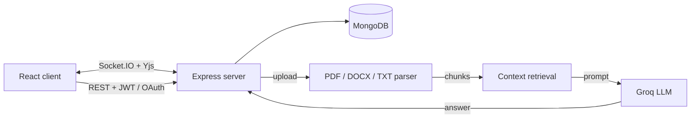
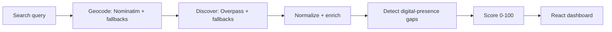

<div align="center">


<a href="https://github.com/Raju-CS8">
  
</a>

<br/>

[](https://nerual-ai.vercel.app/)
[](https://linkedin.com/in/raju-p-08737a2a5)
[](mailto:rajupalani811@gmail.com)


</div>

---

## `> whoami`

```python
class Raju:
    role        = "Full Stack Developer"
    education   = "MCA @ CHRIST (Deemed to be University), 2025-2027"
    base        = "Bengaluru, India"
    core_stack  = ["React", "Node.js", "Express", "FastAPI", "MongoDB", "PostgreSQL"]
    obsessed_with = ["real-time systems", "backend reliability", "LLM-powered products"]
    ships_with  = ["tests", "CI", "auth + RBAC", "rate limiting", "measurable results"]
    looking_for = "Entry-level roles & internships (PPO preferred)"

    def philosophy(self):
        return "If it isn't tested, it isn't done."
```

I build full-stack products end to end: React on the front, Node/Express or FastAPI on the back, MongoDB or PostgreSQL underneath. I like the parts people don't see: job queues that don't double-process, auth that's enforced on the server, APIs that fail with useful errors.

---

## `> impact --numbers`

<div align="center">

| 🧪 **52 / 52** | 🧪 **48 / 48** | ⚡ **6.49 jobs/sec** | 🏗️ **3 projects** | 🧑‍🔬 **2 AI/ML internships** |
|:---:|:---:|:---:|:---:|:---:|
| Jest tests, NeuralIQ | Tests, JobFlow | 200 jobs, 3 workers | Shipped with CI/tests | Infosys Springboard, Acmegrade |

</div>

---

## `> ls ./tech-stack`

<div align="center">

### 🎨 Frontend
<br/>
<sub>React.js · React Hooks · TypeScript · JavaScript · HTML5 · CSS3 · Tailwind CSS · Material UI</sub>

### ⚙️ Backend & APIs
<br/>
<sub>Node.js · Express.js · FastAPI · REST APIs · API Integration · WebSockets · Socket.IO</sub>

### 🗄️ Databases

<br/>
<sub>MongoDB · PostgreSQL · MySQL · SQLAlchemy · SQL</sub>

### 🧪 Testing, Version Control & CI/CD


<br/>
<sub>Git · GitHub · GitHub Actions · Jest · Supertest · Pytest</sub>

### ☁️ Deployment & Cloud

<br/>
<sub>Vercel · Render · AWS (EC2, S3)</sub>

### 🔐 Security & Auth


<br/>
<sub>JWT · OAuth 2.0 · RBAC · Input Validation · Rate Limiting · Helmet · CORS</sub>

### 🤖 AI & ML


<br/>
<sub>LLM integration (Groq) · Chunk-based context retrieval · Machine Learning · XGBoost · Data Cleaning · Deep Learning (MNIST)</sub>

### 🧠 Languages & Fundamentals
<br/>
<sub>JavaScript · TypeScript · Python · SQL · Object-Oriented Programming</sub>

</div>

---

## `> ./projects --featured`

### 🧠 NeuralIQ: Real-Time Collaborative AI Workspace
[](https://nerual-ai.vercel.app/)


Multiple people edit a document at the same time (**Yjs**), upload PDF, DOCX and TXT files, and ask an LLM questions answered from the file's own content via chunk-based retrieval on the **Groq API**. Auth is JWT plus Google OAuth 2.0, with RBAC enforced on the backend, rate limiting and admin authorization.

`React` `Node.js` `Express` `MongoDB` `Socket.IO` `Yjs` `Groq API` `JWT` `OAuth 2.0` `Jest` `Supertest`



<details>
<summary><b>What's under the hood</b></summary>

- Real-time document editing with Yjs, workspace collaboration and file uploads
- Backend-enforced RBAC, rate limiting and admin authorization
- 52/52 Jest tests across 8 suites (auth, workspace, retrieval, authorization, payment, usage), including 12 Supertest API tests

</details>

---

### ⚙️ JobFlow: Concurrent Background Job Processing Platform
[](https://github.com/Raju-CS8/JobFlow)


Priority-based scheduling, concurrent workers that claim jobs with `FOR UPDATE SKIP LOCKED` so no two workers take the same job, automatic retries, persistent execution tracking, failure recovery and idempotent processing. Includes concurrent-worker tests and GitHub Actions CI.

`Python` `FastAPI` `PostgreSQL` `SQLAlchemy` `Pytest` `GitHub Actions`


---

### 🎯 AI Lead Intelligence Engine: B2B Lead Scoring Platform
[](https://github.com/Raju-CS8/AI-Lead-Engine---Automated-Lead-Generation-Filtering-System)

Finds businesses through OpenStreetMap/Overpass, normalizes and enriches the listings, detects digital-presence gaps, and gives each lead a deterministic **0-100 opportunity score**. Reliability work: request validation, timeout handling, multi-endpoint Overpass and Nominatim fallbacks, structured errors, logging, Helmet, CORS and rate limiting.

`React` `TypeScript` `Node.js` `Express` `OpenStreetMap` `Overpass API` `Nominatim`



---

## `> git log --experience`

| Role | Company | When | What I built |
|---|---|---|---|
| **AI/ML Intern** | Infosys Springboard | Feb - Apr 2025 | **GlucoSense**: diabetes-risk prediction app (Python, XGBoost, Streamlit), covering preprocessing, training, evaluation and deployment |
| **AI/ML Intern** | Acmegrade Pvt Ltd | Dec 2023 - Jan 2024 | Handwritten digit classifier on MNIST: deep-learning workflow with held-out evaluation |

---

## `> cat education.md`

- 🎓 **MCA**: CHRIST (Deemed to be University), Bengaluru · 2025 - 2027 · CGPA 7.5/10
- 🎓 **B.Sc. Computer Science**: Don Bosco College (Co-Ed), Tirupattur · 2022 - 2025 · CGPA 7.1/10

**Certifications**
[](https://www.cloudskillsboost.google/)
[](https://infyspringboard.onwingspan.com/)
[](https://infyspringboard.onwingspan.com/)
[](https://www.mckinsey.org/)

---

## `> status --now`

| | |
|---|---|
| 🔭 **Building** | Full-stack and backend projects with tests and CI from day one |
| 📚 **Sharpening** | System design, concurrency, LLM application patterns |
| 🎯 **Looking for** | SDE-1, Full Stack, Backend, Frontend/React, Python and AI/ML roles and internships (PPO preferred) |
| 📍 **Where** | Bengaluru, Pune, Mumbai or remote |

---

## `> stats --github`

<div align="center">


</div>

---

## `> ping --me`

Hiring for a Full Stack, Backend, SDE or AI/ML role, fresher or intern? I'd like to hear about it.

<div align="center">

[](https://linkedin.com/in/raju-p-08737a2a5)
[](mailto:rajupalani811@gmail.com)
[](https://nerual-ai.vercel.app/)


</div>
