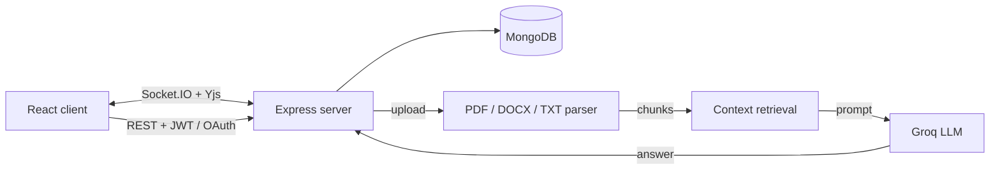
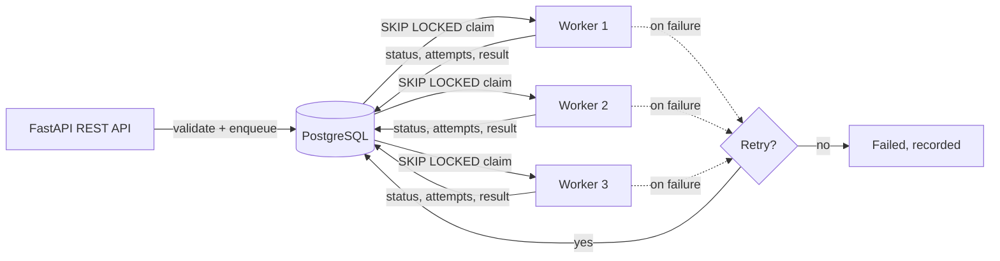
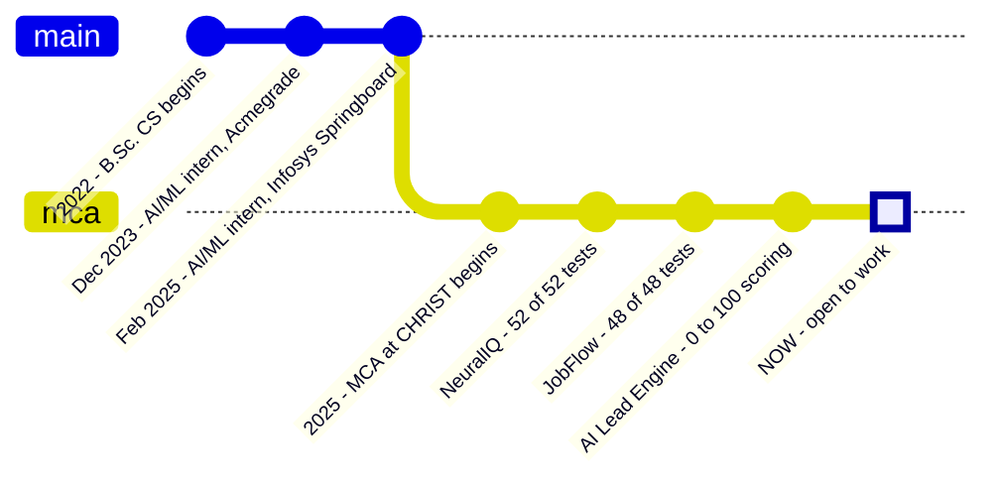

<div align="center">

```text
╔══════════════════════════════════════════════════════════════════╗
║                                                                  ║
║   ██████╗  █████╗      ██╗██╗   ██╗    ██████╗                   ║
║   ██╔══██╗██╔══██╗     ██║██║   ██║    ██╔══██╗                  ║
║   ██████╔╝███████║     ██║██║   ██║    ██████╔╝                  ║
║   ██╔══██╗██╔══██║██   ██║██║   ██║    ██╔═══╝                   ║
║   ██║  ██║██║  ██║╚█████╔╝╚██████╔╝    ██║                       ║
║   ╚═╝  ╚═╝╚═╝  ╚═╝ ╚════╝  ╚═════╝     ╚═╝                       ║
║                                                                  ║
║   SDE  ·  Full Stack  ·  AI                                      ║
║   Bengaluru  ·  Pune  ·  Mumbai  ·  Everywhere                   ║
║                                                                  ║
╠══════════════════════════════════════════════════════════════════╣
║  STATUS    ONLINE · open to work                                 ║
║  LOOKING   entry-level roles & internships (PPO preferred)       ║
║  ROLES     SDE-1 · Full Stack · Backend · Frontend · AI/ML       ║
║  BUILDS    real-time systems · reliable backends · LLM products  ║
║  PROOF     52/52 tests · 48/48 tests · 6.49 jobs/sec · live demo ║
╚══════════════════════════════════════════════════════════════════╝
```

**[01 Brief](#brief)** · **[02 Paths](#paths)** · **[03 Scoreboard](#scoreboard)** · **[04 Builds](#builds)** · **[05 Puzzle](#puzzle)** · **[06 Stack](#stack)** · **[07 Timeline](#timeline)** · **[08 Honest notes](#honest)** · **[09 Talk](#talk)**

</div>

> [!TIP]
> **Hiring?** Skip to the [30-second brief](#brief). **Engineer?** Go straight to the [puzzle](#puzzle). **Curious?** Pick a [path](#paths) and I'll show you the version of this page that fits.

<br/>

<a id="brief"></a>
## 01 · The 30-second brief

| | |
|---|---|
| **Who** | Raju P, MCA student at CHRIST (Deemed to be University), Bengaluru · 2025 to 2027 · CGPA 7.5/10 |
| **Looking for** | Entry-level roles and internships, PPO preferred: SDE-1, Full Stack, Backend, Frontend/React, Python, AI/ML |
| **Where** | Bengaluru · Pune · Mumbai · remote, work-from-anywhere or global |
| **Core stack** | React · Node.js / Express · FastAPI · MongoDB · PostgreSQL · TypeScript · Python |
| **Proof** | 52/52 Jest tests on NeuralIQ[^1] · 48/48 tests with CI on JobFlow[^2] · 6.49 jobs/sec benchmark · a [live demo](https://nerual-ai.vercel.app/) you can open right now |
| **Experience** | 2 AI/ML internships: Infosys Springboard (2025) and Acmegrade (2023 to 2024) |
| **Reach me** | [rajupalani811@gmail.com](mailto:rajupalani811@gmail.com) · [LinkedIn](https://linkedin.com/in/raju-p-08737a2a5) |

<br/>

<a id="paths"></a>
## 02 · Pick your path

Same person, three different pages. Open the one that sounds like you.

<details>
<summary><b>👔 I'm screening candidates</b></summary>

<br/>

You have a minute, so here is the shortest honest version:

- **Fit:** fresher (MCA 2025 to 2027) aimed at SDE-1, Full Stack, Backend and AI/ML roles, with two internships and three tested projects behind it.
- **Strongest evidence:** the [scoreboard](#scoreboard). Test counts, a throughput number and a live product, not adjectives.
- **Keywords you may be searching for:** React.js, Node.js, Express.js, REST APIs, FastAPI, MongoDB, PostgreSQL, TypeScript, Python, JWT, OAuth 2.0, RBAC, Jest, Pytest, GitHub Actions, Vercel, Render, AWS. The full list is in the [stack](#stack).
- **Next step:** [email me](mailto:rajupalani811@gmail.com) or message me on [LinkedIn](https://linkedin.com/in/raju-p-08737a2a5).

</details>

<details>
<summary><b>🧑‍💻 I'm an engineer</b></summary>

<br/>

Skip the marketing. Things I'm happy to go deep on:

- Claiming jobs with `FOR UPDATE SKIP LOCKED` so concurrent workers never double-process, plus retries and idempotent processing ([try the puzzle](#puzzle))
- Real-time collaborative editing with Yjs and Socket.IO, and how it sits next to a REST API
- Chunk-based retrieval so an LLM answers from the user's own PDF, DOCX or TXT
- Making flaky third-party APIs survivable: timeouts, multi-endpoint fallbacks for Overpass and Nominatim, structured errors
- Backend-enforced RBAC, and why the client is never the source of truth

Start with the [architecture diagrams](#builds).

</details>

<details>
<summary><b>🚀 I'm a founder or hiring manager</b></summary>

<br/>

What a fresher who ships can do for a small team:

- **Real-time features:** collaborative editing, live updates, workspaces with roles
- **LLM features that use your data:** upload a document, ask questions, get answers grounded in it
- **Background work that doesn't fall over:** queues, workers, retries, failure recovery
- **Secure APIs fast:** JWT and OAuth 2.0 auth, RBAC, rate limiting, validation, tests and CI from the first commit
- **ML prototype to working app:** I've taken a model from preprocessing to a deployed Streamlit app (GlucoSense)

I'm looking for a team where I can own a real piece of the product. PPO preferred.

</details>

<br/>

<a id="scoreboard"></a>
## 03 · Scoreboard

```text
 TESTS
 NeuralIQ    jest + supertest   ████████████████████  52 / 52   8 suites
 JobFlow     automated tests    ████████████████████  48 / 48   GitHub Actions CI

 THROUGHPUT
 JobFlow     3 concurrent workers      200 jobs  >>  6.49 jobs/sec

 SCORING
 AI Lead Engine   deterministic opportunity score   0 ─────────────── 100

 SHIPPED
 NeuralIQ    live on Vercel   https://nerual-ai.vercel.app/
```

<br/>

<a id="builds"></a>
## 04 · What I've built

### 🧠 NeuralIQ · real-time collaborative AI workspace

People edit documents together in real time (Yjs), upload PDF, DOCX and TXT files, and ask an LLM questions that are answered from the file's own content using chunk-based retrieval on the Groq API. Auth is JWT plus Google OAuth 2.0, with RBAC enforced on the backend, rate limiting and admin authorization.

`React` `Node.js` `Express` `MongoDB` `Socket.IO` `Yjs` `Groq API` `JWT` `OAuth 2.0` `Jest` `Supertest`

**[Open the live demo →](https://nerual-ai.vercel.app/)**

<details>
<summary><b>See the architecture</b></summary>



</details>

### ⚙️ JobFlow · concurrent background job processing

Priority-based scheduling, concurrent workers that claim jobs with `FOR UPDATE SKIP LOCKED`, automatic retries, persistent execution tracking, failure recovery and idempotent processing. Benchmarked at 200 jobs and 6.49 jobs/sec with 3 workers.

`Python` `FastAPI` `PostgreSQL` `SQLAlchemy` `Pytest` `GitHub Actions`

**[Read the code →](https://github.com/Raju-CS8/JobFlow)**

<details>
<summary><b>See the architecture</b></summary>



</details>

### 🎯 AI Lead Intelligence Engine · B2B lead scoring

Finds businesses through OpenStreetMap/Overpass, normalizes and enriches the listings, detects digital-presence gaps, and gives each lead a deterministic 0 to 100 opportunity score. Reliability work includes request validation, timeout handling, multi-endpoint Overpass and Nominatim fallbacks, structured errors, logging, Helmet, CORS and rate limiting.

`React` `TypeScript` `Node.js` `Express` `OpenStreetMap` `Overpass API` `Nominatim`

**[Read the code →](https://github.com/Raju-CS8/AI-Lead-Engine---Automated-Lead-Generation-Filtering-System)**

<details>
<summary><b>See the pipeline</b></summary>


</details>

<br/>

<a id="puzzle"></a>
## 05 · Quick puzzle: the double-booked job

Two workers poll the same `jobs` table. Each one runs this:

```sql
SELECT id FROM jobs WHERE status = 'queued' LIMIT 1;
-- ...then, in a separate statement:
UPDATE jobs SET status = 'running' WHERE id = :id;
```

**What goes wrong when both workers run it at the same moment?** Think about it, then open the answer.

<details>
<summary><b>Show the answer</b></summary>

<br/>

Both workers can read the same row before either one updates it, so the same job runs twice. Under load this shows up as duplicate emails, double charges and flaky tests.

The fix is to claim the job in a single atomic statement and let other workers skip rows that are already locked:

```sql
WITH next AS (
  SELECT id FROM jobs
  WHERE status = 'queued'
  ORDER BY priority DESC, created_at
  FOR UPDATE SKIP LOCKED
  LIMIT 1
)
UPDATE jobs
SET status = 'running'
FROM next
WHERE jobs.id = next.id
RETURNING jobs.*;
```

That is the pattern behind how JobFlow's workers claim work. Retries and idempotent processing cover the rest: a crashed worker must not leave a job stuck, and a re-run must not repeat its side effects.

</details>

<br/>

<a id="stack"></a>
## 06 · Stack

```yaml
frontend:   [React.js, React Hooks, TypeScript, JavaScript, HTML5, CSS3, Tailwind CSS, Material UI]
backend:    [Node.js, Express.js, FastAPI, REST APIs, API integration, WebSockets, Socket.IO]
realtime:   [Socket.IO, WebSockets, Yjs]
databases:  [MongoDB, PostgreSQL, MySQL, SQLAlchemy, SQL]
languages:  [JavaScript, TypeScript, Python, SQL, OOP]
testing_ci: [Jest, Supertest, Pytest, Git, GitHub, GitHub Actions]
cloud:      [Vercel, Render, AWS EC2, AWS S3]
security:   [JWT, OAuth 2.0, RBAC, input validation, rate limiting, Helmet, CORS]
ai_ml:      [Groq API, LLM apps, chunk-based retrieval, Machine Learning, XGBoost, Streamlit, Data Cleaning, Deep Learning]
```

**Across my projects, the checklist I hold myself to:**

- [x] Automated tests, not just manual clicking
- [x] CI on GitHub Actions
- [x] Input validation on every API
- [x] Auth and RBAC enforced on the server
- [x] Rate limiting, Helmet and CORS controls
- [x] Timeouts, fallbacks and structured errors for anything external
- [x] Logging, so failures can be explained

<br/>

<a id="timeline"></a>
## 07 · My timeline, as a git log



| Role / Degree | Where | When | What |
|---|---|---|---|
| **AI/ML Intern** | Infosys Springboard | Feb to Apr 2025 | **GlucoSense**: diabetes-risk prediction (Python, XGBoost, Streamlit) with preprocessing, training, evaluation and deployment |
| **AI/ML Intern** | Acmegrade Pvt Ltd | Dec 2023 to Jan 2024 | Handwritten digit classifier on MNIST with a deep-learning workflow and held-out evaluation |
| **MCA** | CHRIST (Deemed to be University), Bengaluru | 2025 to 2027 | CGPA 7.5/10 |
| **B.Sc. Computer Science** | Don Bosco College (Co-Ed), Tirupattur | 2022 to 2025 | CGPA 7.1/10 |

**Certifications:** Gemini for End-to-End SDLC (Google Cloud Skills Boost) · Introduction to Large Language Models (Infosys Springboard) · Artificial Intelligence (Infosys Springboard) · Forward Program (McKinsey.org)

<br/>

<a id="honest"></a>
## 08 · Honest notes

- **I'm a fresher.** My evidence is shipped projects with tests and numbers, not years on a payroll.
- **The numbers on this page come from my own test runs and benchmark.** Where a repo is linked, you can go and check.
- **My internship work was ML** (GlucoSense, MNIST). I'm now applying across Full Stack, Backend and AI/ML, and my recent projects are all full-stack and backend.
- **If a role needs something I haven't done yet, I'll say so plainly** and tell you how I'd close the gap.

<br/>

<a id="talk"></a>
## 09 · Let's talk

| | |
|---|---|
| 📧 **Email** | [rajupalani811@gmail.com](mailto:rajupalani811@gmail.com) |
| 💼 **LinkedIn** | [linkedin.com/in/raju-p-08737a2a5](https://linkedin.com/in/raju-p-08737a2a5) |
| 🧪 **Try something I built** | [NeuralIQ live demo](https://nerual-ai.vercel.app/) |
| 📍 **Where I can work** | Bengaluru · Pune · Mumbai · Everywhere |

<details>
<summary>🥚 You scrolled all the way down</summary>

<br/>

Put `SKIP LOCKED` in the subject line of your email. I'll know you read the whole page, and I'll reply to you first.

</details>

```text
$ exit 0    # thanks for reading
```

[^1]: 8 Jest suites covering authentication, workspace, retrieval, authorization, payment and usage workflows, including 12 Supertest API tests.
[^2]: Concurrent-worker tests and GitHub Actions CI. The throughput figure is 200 jobs processed by 3 workers.
